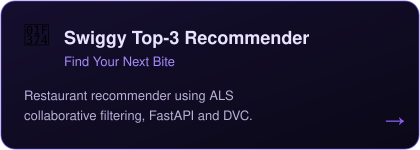
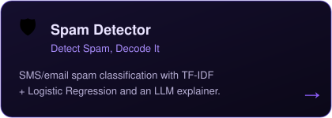
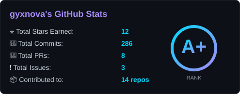
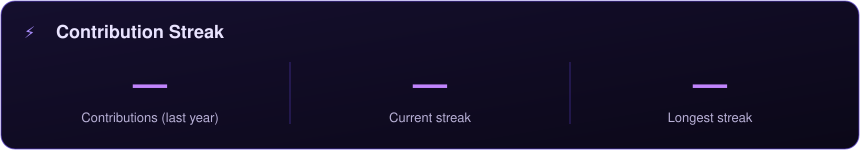

# gyxnova ⚡

**Aspiring AI/ML Engineer | Mathematics Student**

*“Turning curiosity into code, and data into intelligence.”*

📍 India &nbsp;·&nbsp; ✉️ [gsharma27084@gmail.com](mailto:gsharma27084@gmail.com) &nbsp;·&nbsp; 🔗 [LinkedIn](https://www.linkedin.com/in/gayatri-sharma-852a78349)

<table>
<tr>
<td width="68%" valign="middle">

</td>
<td width="32%" valign="middle" align="center">

</td>
</tr>
</table>

## ⚡ Tech Stack

| Area | Tools and topics |
|---|---|
| Programming | Python, SQL |
| Data | NumPy, Pandas, Matplotlib, Seaborn |
| Machine Learning | scikit-learn, regression, classification, feature engineering, model evaluation |
| Currently learning | TensorFlow, Deep Learning, MLOps |
| Tools | Git, GitHub, Jupyter Notebook, VS Code |

## 🚀 Featured Projects

## 📊 GitHub Stats

---

**✦ &nbsp; DREAM BIG. CODE HARDER. &nbsp; ✦**

*Keep Building* ⚡

 

